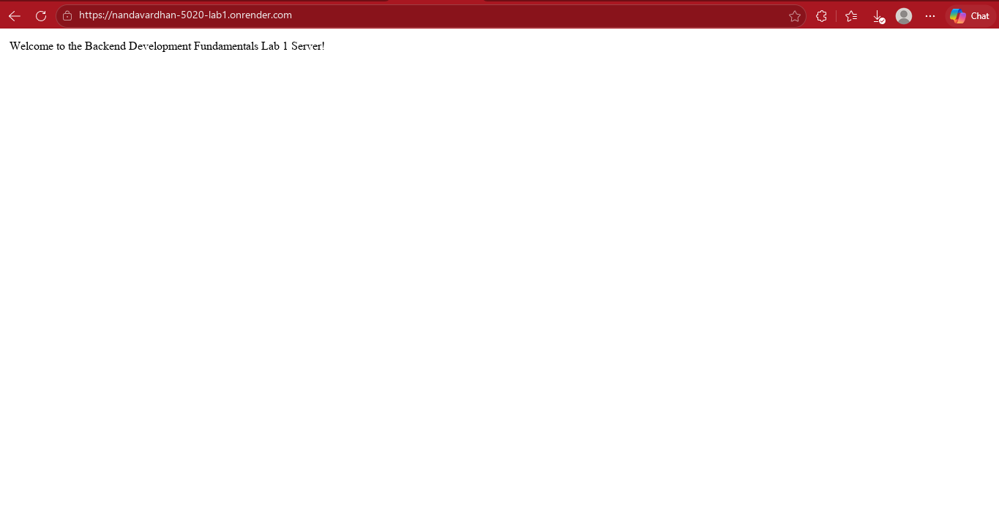
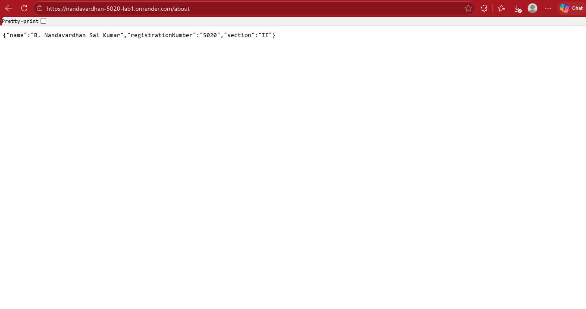
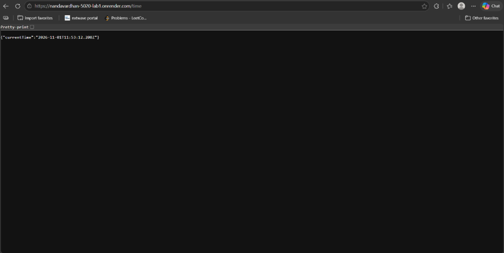
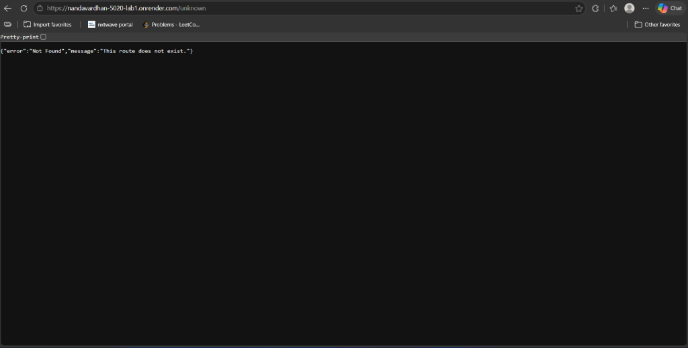

Deployed_Link: https://nandavardhan-5020-lab1.onrender.com/

# Lab 1: Node.js and Express Server

**Deployed Link:** https://nandavardhan-5020-lab1.onrender.com/

---

## Student Details
* **Name:** Bangaru Nandavardhan Sai Kumar
* **Roll Number:** 252U1R5020
* **Course:** B.Tech – Computer Science and Engineering
* **Year:** II Year
* **Section:** 106 CSE-AIDE(2A)
* **Subject:** Backend Development Fundamentals
* **Lab Number:** 01

---

## Project Overview
This project demonstrates the fundamentals of Node.js and Express.js by creating a basic web server. First, a server is developed using Node.js's built-in HTTP module (`plain-server.js`). Then, the server is implemented using Express.js (`server.js`) with custom request logging middleware and multiple routes to handle HTTP requests and responses.

---

## Technologies Used
* Node.js
* Express.js
* JavaScript
* npm (Node Package Manager)
* Visual Studio Code

---

## Project Structure
```text
NANDAVARDHAN-5020-LAB1/
│
├── server.js
├── plain-server.js
├── package.json
├── package-lock.json
├── .gitignore
├── README.md
└── screenshots/
    ├── home.png
    ├── about.png
    ├── time.png
    ├── Unknown.png
    └── server-run.png
```

---

## Installation and Setup

### 1. Clone the Repository
```bash
git clone https://github.com/nvsk07/NANDAVARDHAN-5020-LAB1.git
```

### 2. Navigate to the Project Folder
```bash
cd NANDAVARDHAN-5020-LAB1
```

### 3. Install Dependencies
```bash
npm install
```

### 4. Start the Express Server
```bash
npm start
```


```text
http://localhost:3000
```

### 5. Run the Plain Node.js HTTP Server
```bash
npm run start:http
```
> **Note:** Stop the Express server before starting the plain HTTP server because both use port 3000 by default.

---

## API Endpoints

| HTTP Method | Endpoint | Description | Status Code |
| :--- | :--- | :--- | :--- |
| **GET** | `/` | Displays a welcome message | 200 OK |
| **GET** | `/about` | Returns student name, registration number, and section in JSON format | 200 OK |
| **GET** | `/time` | Returns the current server date and time in ISO format | 200 OK |
| **GET** | `/unknown` | Displays a 404 error for an unknown route | 404 Not Found |

---

## Screenshots

### 1. Home Route
Displays the welcome message.  


### 2. About Route
Displays student information in JSON format.  


### 3. Time Route
Displays the current date and time.  


### 4. 404 Not Found
Displays an error message for an invalid route.  


---

## Viva Questions and Answers

1. **What is the difference between `package.json` and `node_modules`?**  
   `package.json` contains project metadata, scripts, and dependencies list, whereas `node_modules` contains the actual installed libraries and packages needed for the project to run.

2. **What does `app.listen()` do?**  
   The `app.listen()` method binds and listens for incoming HTTP connections on the specified port and host.

3. **What do request and response represent?**  
   - **Request (`req`):** Represents the HTTP request sent by the client (browser, curl, Postman), including headers, URL parameters, query strings, and body.  
   - **Response (`res`):** Represents the HTTP response sent back by the server to the client, carrying data, status codes, and response headers.

4. **What is middleware in Express.js?**  
   Middleware functions in Express have access to the request object (`req`), response object (`res`), and the `next` function in the application's request-response cycle. They can execute code, modify request/response objects, end the request-response cycle, or call the next middleware.

---

## Learning Outcomes
* Understood the fundamentals of Node.js and Express.js architecture.
* Initialized and managed dependencies using npm (`package.json`, `package-lock.json`).
* Created a native HTTP server using Node.js's built-in `http` module.
* Developed an Express server with custom request-logging middleware.
* Handled multiple GET routes serving both plain text and JSON data.
* Implemented proper HTTP status codes (200 OK, 404 Not Found) and error handling.
* Deployed the web service to cloud infrastructure (Render) and verified live endpoints.

---

## Author
**Bangaru Nandavardhan Sai Kumar**  
* **Roll Number:** 252U1R5020  
* **Course:** B.Tech – Computer Science and Engineering  
* **Year & Section:** II Year – 106 CSE-AIDE(2A)  
* **Institution:** Aurora Higher Education and Research Academy  

